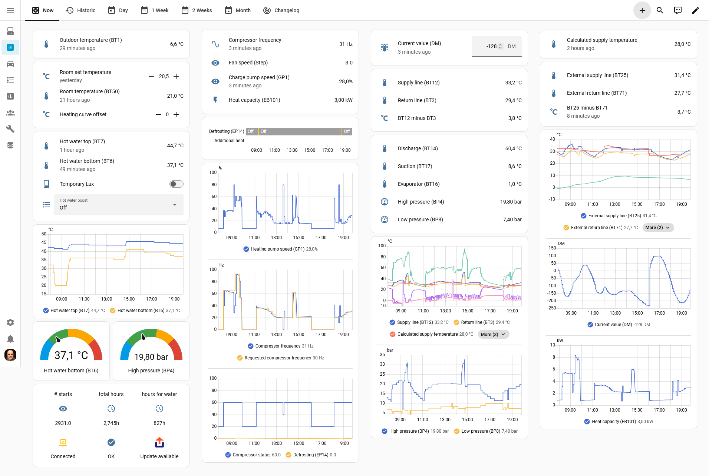

# haos-nibe-smo-20
Home Assistant - Nibe SMO-20

1. Create new **Home Assistant** dashboard from scratch  
   Navigate to `Settings` > `Dashboards` > `+ Add dashboard` > `New dashboard from scratch`

2. Edit dashboard raw configuration  
   View new dashboard > $\vdots$ (top right) > `Raw configuration editor`

3. Paste in new configuration > `Save`  
   [dashboard-heating-system.yaml](https://raw.githubusercontent.com/dandragut/haos-nibe-smo-20/refs/heads/main/dashboard-heating-system.yaml)

